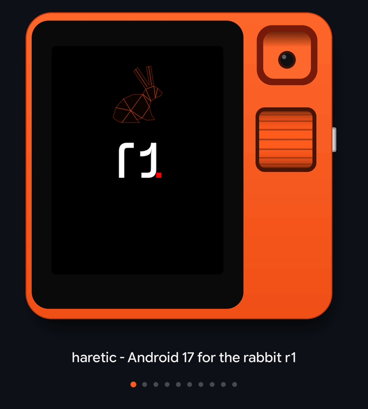

# haretic

<picture>
  <source media="(prefers-color-scheme: dark)" srcset="https://github.com/haretic/.github/raw/main/profile/tour.gif">
  <source media="(prefers-color-scheme: light)" srcset="https://github.com/haretic/.github/raw/main/profile/tour-light.gif">
  
</picture>

*Philosophy: Trying to answer the question*
> What if Teenage Engineering made the OS, too?

haretic is a custom operating system for the rabbit r1, based on Android 17 and Linux 7.3.4 kernel (mainline, released in November 2026).  

rabbitOS is replaced entirely. Custom kernel, rootfs, drivers, vendor.  
Android is based on LineageOS 24, with heavy UI modifications to fit the r1's 480x640 screen and wheel. A lot of restrictions on the hardware imposed by rabbitOS have been [removed](https://github.com/haretic/release#rabbitos).  

Also, this is kind of a high effort shitpost. Don't get me wrong, the ROM is completely serious and great to use. But Bringus Studio's [video](https://www.youtube.com/watch?v=_ClDFu1WmtM) is what made me get the r1 to tinker with, and this ROM is a hommage to it.  
The r1 could run much better than in the video. Jon, if you see this, please give it a shot.

### Install via the **[haretic installer](https://github.com/haretic/installer/releases/)**
Install steps should be simple - download the installer and plug in your rabbit while it is turned **off**.  
The tool will take care of all the requisite steps for you to install haretic from whatever base you are coming from, including installing the haretic loader and downloading the latest release.

**Warning Ubuntu Touch users:** I have not tested installing from an active UT install. I don't know if the haretic flasher can flash to a bootable state from it.

Port status: stable. daily driver for me, however it's not 100% bug-free

## What works
- WiFi/Bluetooth/BLE
- RIL/Mobile data (telephony untested)
- SoC sleep
- PowerVR GE8320 GPU acceleration and 90Hz screen refresh rate (rabbitOS cap removed)
- Camera (Hi-846) through libcamera with hardware ISP and painstaking manual calibration
- front and back by turning the motor
- Accelerometer and gyroscope
- Audio: speaker and microphone
- GPS
- Hardware video encode/decode (Codec2)
- Battery, fuel gauge and charging, with Lineage charging limit (down to 50%)
- USB device mode and adb; emulate USB touchpads, keyboards, flash drives, CD ROM drives or a sound card using a USB C cable
- OTA updates from the device itself
- GAME performance modes and overclocks (hello bringus dingus)
- Kernel Tweaks to customize aspects of the system performance
- Optional rooted image with Magisk 30.7 (update to v31 is not installed since su prompts are desired)

It should theoretically be possible to flash GSIs on top of haretic. This was not tested during development, though.

## What doesn't
- Calls and SMS untested
- tell me in GitHub issues

## versus rabbitOS
- **This OS is a lot faster than rabbitOS.** This is not necessarily a fault of theirs and a win of mine because,
- ~~**This OS uses a lot more battery than rabbitOS.** The MT6765 is not officially supported in the mainline kernel, and while I have done power optimizations, I cannot be certain I match those of the MediaTek vendor BSP.~~ Recent builds have quite good energy efficiency while boosting quickly when the CPU gets load. To additionally help out with that though,
- **The OS ships an extreme power save mode** in Settings > Performance. This mode is close to what rabbitOS runs in, which preserves battery life on this unit. The screen is set to 60Hz and the CPU is underclocked.
- ~~The kernel is tweaked more for performance at the moment than battery life. Future updates will improve that without sacrificing performance in those modes.~~ Future updates have arrived, and the kernel smoothly scales depending on the workload. Battery life should not be impacted much versus other Android on r1 installs, especially in battery saver performance profile.

## versus GSIs on top of rabbitOS
Pretty much better in all regards.  
GSIs have been a buggy mess for me on the r1.  
This OS runs fast and stable, and can last a while when the right performance profile is set.  

## Help  
Running into issues? Report a problem via [GitHub issues](https://github.com/haretic/release/issues/new/choose) or join our [Telegram](https://t.me/haretic_r1) group.

## Links
Official sister project to [andr36oid](https://github.com/andr36oid) - Android for the R36S series of ultra-cheap gaming consoles.
